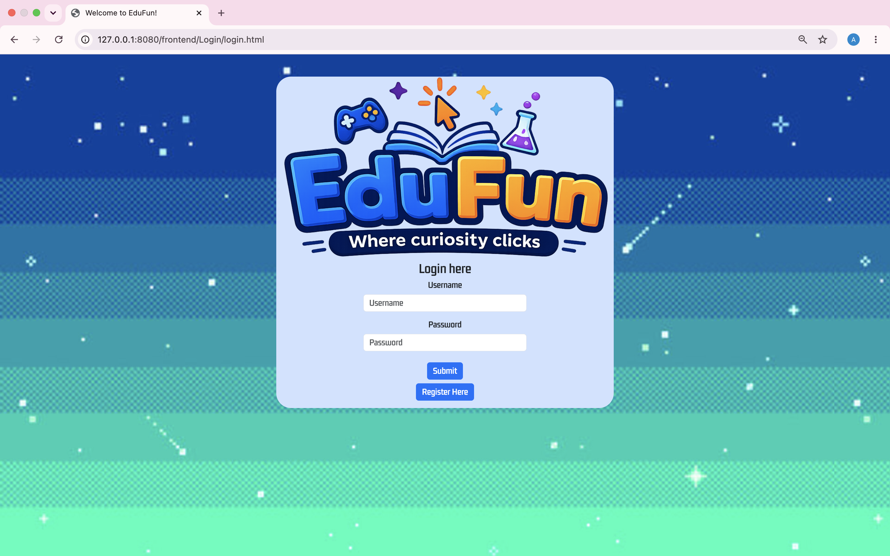
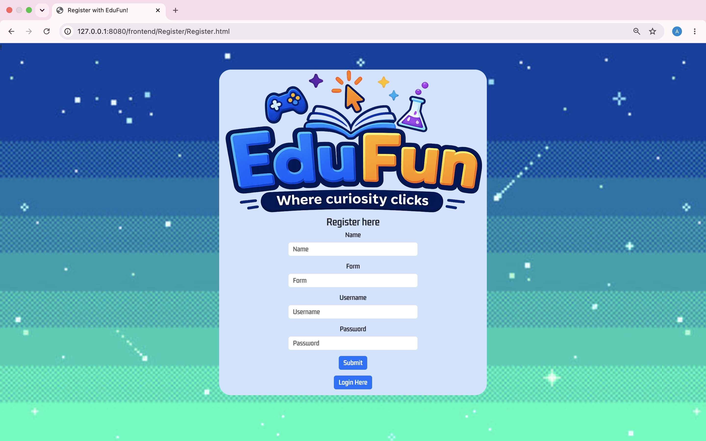
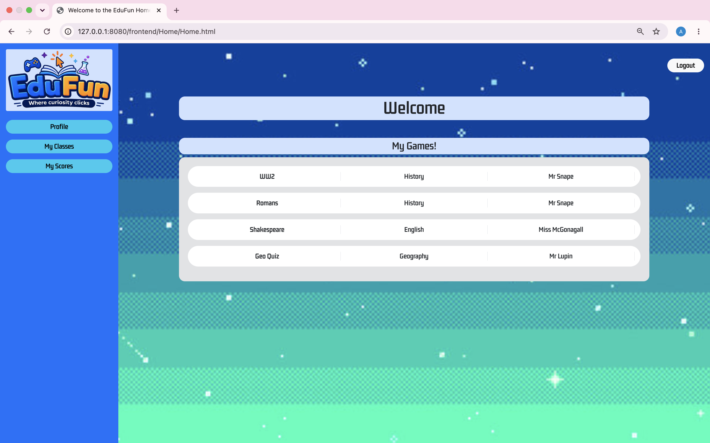
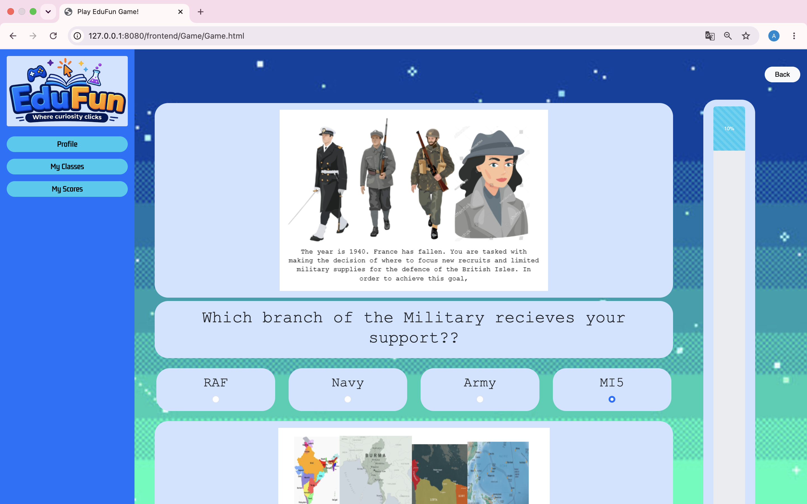
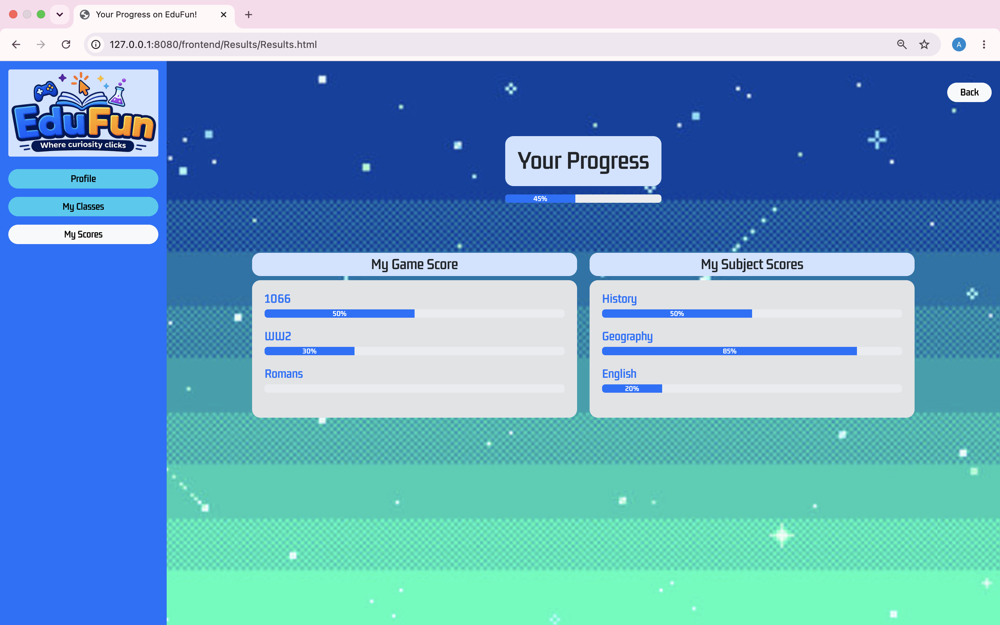

# EduFun

> A team project developed at La Fosse Academy, focused on building an educational gaming platform with a Node.js and Express backend, PostgreSQL integration, REST APIs and automated testing.

EduFun is a full-stack educational gaming platform designed to make learning more engaging through interactive, scenario-based challenges. Users can register, complete educational quizzes, track their progress and review their results.

## Overview

The project combines a web frontend with a RESTful backend built using Node.js and Express. PostgreSQL provides database integration, while Jest and Supertest support automated unit and API integration testing.

## Technologies

| Area | Technologies |
|---|---|
| Backend | Node.js, Express, JavaScript |
| Database | PostgreSQL |
| API | REST |
| Testing | Jest, Supertest |
| Frontend testing | JSDOM |
| Development | Git, GitHub, Agile methodologies |

## Key Features

- User registration and authentication
- Interactive educational quiz challenges
- Scenario-based learning
- Progress tracking and results management
- RESTful API architecture
- MVC backend structure
- Automated unit and API integration tests

## Architecture

```text
Frontend
    ↓
REST API
    ↓
Express
    ↓
PostgreSQL
```

## Screenshots

### Login and Registration

| Login | Registration |
|---|---|
|  |  |
| User sign-in interface. | New-user registration interface. |

### Learning Experience

| Home | Game |
|---|---|
|  |  |
| Entry point for accessing learning activities. | Interactive educational challenge interface. |

### Results and Progress



## My Contribution

My contributions focused on backend development and included work across API design, database integration, authentication and automated testing.

Key areas of work included:

- Developing REST API functionality using Node.js and Express.
- Integrating PostgreSQL for application data persistence.
- Working on registration and login functionality, including JWT issuance.
- Writing and maintaining automated tests using Jest and Supertest.
- Improving test reporting to measure backend source-code coverage.
- Collaborating through Git, feature branches and Agile practices.

## Testing and Coverage

The backend uses Jest for unit tests and Supertest for API integration tests.

### Run backend tests

From the repository root:

```bash
cd backend
npm install
npm test
```

Run unit tests separately:

```bash
npm run unitTests
```

Run API integration tests separately:

```bash
npm run integrationTests
```

### Backend coverage

Generate the coverage report:

```bash
npm run coverage
```

The reported results were:

| Metric | Coverage |
|---|---:|
| Statement coverage | 87.86% |
| Branch coverage | 64.10% |
| Function coverage | 85.18% |
| Line coverage | 87.71% |

Coverage is collected from backend source files, excluding test files, the server entry point and database setup.

The API tests use mocked model dependencies, so they validate API behaviour without relying on a live database for those tests.

## Installation and Setup

### Clone the repository

```bash
git clone https://github.com/ArshaanSindhwani/EduFun.git
cd EduFun
```

### Backend

Install dependencies:

```bash
cd backend
npm install
```

Start the backend:

```bash
npm start
```

For development:

```bash
npm run dev
```

### Frontend

Open a separate terminal from the repository root:

```bash
cd frontend
npm install
```

Start the frontend:

```bash
npm run dev
```

Run frontend tests:

```bash
npm test
```

The frontend test script uses Jest watch mode.

## What I Learned

- Designing RESTful APIs with Express.
- Integrating PostgreSQL with a Node.js application.
- Structuring backend code using MVC principles.
- Implementing authentication functionality.
- Writing unit and API integration tests.
- Measuring test coverage and identifying untested code.
- Collaborating through Git, feature branches and Agile practices.

## Future Improvements

- Expand automated test coverage, particularly for middleware and error-handling paths.
- Strengthen API validation and error handling.
- Extend educational content and challenge types.
- Improve progress reporting and learning analytics.
- Explore cloud deployment and CI/CD pipelines.